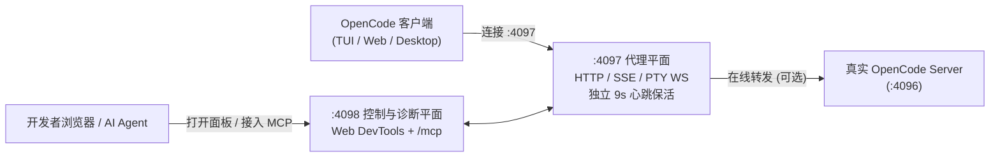

# oc-mock-server 快速介绍与使用指南

> 专为 **OpenCode C/S 架构**（Web / Desktop / TUI）打造的单二进制调试代理、DevTools 控制台、Mock/断点工作台、会话回放器与 AI 诊断工具。

---

## 1. 背景与定位（解决什么痛点？）

在开发和排查 OpenCode 客户端与服务端交互问题时，通常会遇到三个核心痛点：

1. **流式通信难看清**：会话重度依赖 HTTP + 长连接 SSE，单次回复会产生大量 `message.part.delta` 碎片，普通抓包工具难以阅读完整消息与前端状态。
2. **异常与边界难复现**：报错、慢接口、权限弹窗卡死、偶发乱序等场景很难靠真实环境稳定触发；而且一旦暂停流式事件排查，客户端 15 秒收不到心跳就会超时断连重刷。
3. **AI 自诊断成本高**：如果把原始 SSE 帧直接喂给 AI Agent 排障，成百上千条增量帧会瞬间撑爆上下文 Token。

**`oc-mock-server` 的定位**：以**零侵入代理**的方式串在客户端与服务端之间（甚至无需真实服务端即可离线运行），提供类似浏览器 DevTools 的可视化调试体验与面向 AI 的高压缩诊断接口。

---

## 2. 工作原理（双端口零侵入架构）

单个二进制进程同时启动两个独立端口，互不干扰：



- **`:4097` 代理平面（给客户端连）**：完全兼容 OpenCode 服务端协议。内置独立 **9 秒 `server.heartbeat` 保活**，即使打断点或单步暂停回放，客户端也不会断连。
- **`:4098` 控制平面（给开发者和 AI 用）**：内嵌 Web DevTools 控制台（`http://127.0.0.1:4098`）及 Streamable HTTP MCP 接口（`http://127.0.0.1:4098/mcp`）。
- **三种运行模式一键切换**（控制台顶部栏）：
  - `Passthrough`（纯透传）：只抓包记录，自动绕过所有 Mock 和断点规则。
  - `Intercept`（拦截调试）：启用所有已勾选的 HTTP / SSE Mock 改写规则与实时断点。
  - `Replay`（会话回放）：静音上游流，通过内置 `ShadowStore` 挂载虚拟会话并精确回放录像。

---

## 3. 三步快速上手

### 第一步：编译构建

需要本地安装 Node.js 与 Rust 工具链，前端构建产物会自动打包进单个 Rust 可执行文件中：

```bash
make release
```

### 第二步：启动服务（二选一）

```bash
# 方式 A：在线代理模式（转发给运行在 :4096 的真实 OpenCode Server）
./target/release/oc-mock-server serve \
  --upstream http://127.0.0.1:4096 \
  --proxy-addr 127.0.0.1:4097 \
  --control-addr 127.0.0.1:4098

# 方式 B：纯离线模式（无需真实 OpenCode Server，可直接体验内置 Demo 回放与 Mock）
./target/release/oc-mock-server serve --dir $(pwd)
```

### 第三步：打开面板并接入客户端

1. **打开 Web 调试面板**：浏览器访问 `http://127.0.0.1:4098`
2. **连接 OpenCode 客户端**：
   - **TUI 终端**：执行 `opencode attach http://127.0.0.1:4097`
   - **Web / Desktop 客户端**：将服务器地址改为 `http://127.0.0.1:4097`

---

## 4. 四大核心使用场景

Web 控制台左侧按 **Inspect（观测）**、**Simulate（模拟）**、**Integrate（集成）** 分为 7 个面板，对应日常四大场景：

| 使用场景 | 对应面板 | 核心用法 |
| :--- | :--- | :--- |
| **1. 实时抓包与异常体检** | `Network`<br/>`SSE Stream`<br/>`Anomalies` | • 实时查看 HTTP 请求头/体、复制 cURL，一键转为 Mock 规则。<br/>• 自动将连续 `delta` 折叠为完整文本预览，支持单帧手动编辑并重发。<br/>• 一键扫描 4xx/5xx、慢请求、断连风暴、孤儿 `delta`、未响应权限/提问弹窗。 |
| **2. 接口 Mock 与流式改写** | `Mock & AI` | • **HTTP 规则**：支持直接返回（`direct`）、上游响应打补丁（`patch`）、触发合成 SSE 序列。<br/>• **SSE 规则**：支持按事件类型丢弃（`drop`）、修改（`patch`）、替换（`replace`）、延迟（`delay`）。<br/>• **智能生成**：自动同步 `/doc` OpenAPI Schema，支持离线 Faker 秒级造数或接 LLM 生成复杂场景。 |
| **3. 动态断点拦截改包** | `Breakpoints` | • 切换到 `Intercept` 模式后，可对匹配的 **HTTP 请求 / HTTP 响应 / 单帧 SSE 事件**挂起断点。<br/>• 在面板中实时修改状态码、Headers 或 JSON 内容后点击放行，支持 `one_shot` 单次触发自动关闭。 |
| **4. 故障录制与离线回放** | `Replay & Tapes` | • 将任意历史会话一键提取并导出为便携的 `.tape.jsonl` 文件发给协作者。<br/>• 支持播放、暂停、单步（Step）、倍速与进度跳转（Seek），自动完成跨机器工作目录重映射。<br/>• 首次启动自带 `[Demo]` 演示录像，离线模式下可直接播放体验。 |

---

## 5. AI Agent 接入与常用命令速查

除了人工看面板，还可以直接让 OpenCode / AI Agent 自己查流量、定位 Bug（服务端自动做 Delta 折叠，**节省 >95% Token**）。

### 接入 MCP（推荐）

在项目的 `opencode.json` 中添加（对应面板 `MCP & Config`）：

```json
{
  "mcp": {
    "oc-mock-server": {
      "type": "remote",
      "url": "http://127.0.0.1:4098/mcp",
      "oauth": false
    }
  }
}
```

接入后，AI 可直接调用 `list_sessions`、`get_session_timeline`、`find_anomalies`、`reconstruct_state_at`、`create_mock_rule`、`control_replay` 等工具闭环排查问题。

### 常用 CLI 命令

所有子命令均支持追加 `--json` 输出结构化结果：

```bash
# 1. 查看捕获的会话与异常体检
oc-mock-server sessions
oc-mock-server anomalies --slow-ms 2000

# 2. 查看某次会话的时间线（默认折叠 delta）与任意时刻前端状态还原
oc-mock-server timeline <session_id>
oc-mock-server state <session_id> --at-seq 42

# 3. 提取、导出与导入会话回放录像 (.tape.jsonl)
oc-mock-server tape list
oc-mock-server tape extract <session_id> --name "Bug 复现现场"
oc-mock-server tape export <tape_id> -o bug.tape.jsonl
oc-mock-server tape import bug.tape.jsonl

# 4. 命令行快速注入 Mock 或一次性断点
oc-mock-server rules add --name "模拟接口报错" --method GET --path /vcs --status 500 --body '{"error":"boom"}'
oc-mock-server sse-rules add --name "丢弃空闲事件" --event-type session.idle --action-type drop --one-shot
```

---

## 附：会议 3 分钟 Live Demo 演示动线

如果在分享会上做现场演示，推荐按以下顺序操作，无需复杂准备即可展示全部亮点：

1. **离线启动（10 秒）**：执行 `make serve-offline`，打开 `http://127.0.0.1:4098`，并新开终端运行 `opencode attach http://127.0.0.1:4097`。
2. **回放内置录像（1 分钟）**：进入 `Replay & Tapes`，选择内置的 `[Demo] Fix SSE heartbeat & add replay inspector`，点击播放并演示 **Pause / Step 单步推进**，展示 TUI 客户端同步渲染思考过程、工具调用与文件变更，且暂停超过 15 秒依然在线不断连。
3. **抓包与折叠视图（1 分钟）**：切到 `Network` 与 `SSE Stream`，展示刚刚回放过程中捕获的请求和折叠后的清晰事件流；切到 `Anomalies` 展示自动诊断面板。
4. **断点拦截改包（1 分钟）**：顶部切换到 `Intercept` 模式，在 `Breakpoints` 快速添加一个 `/session/*` 响应断点，触发一次请求后现场修改返回 JSON 并放行。

---

> 更多底层协议设计、ShadowStore 状态机语义与数据库结构请参考 [DESIGN.md](./DESIGN.md)。
